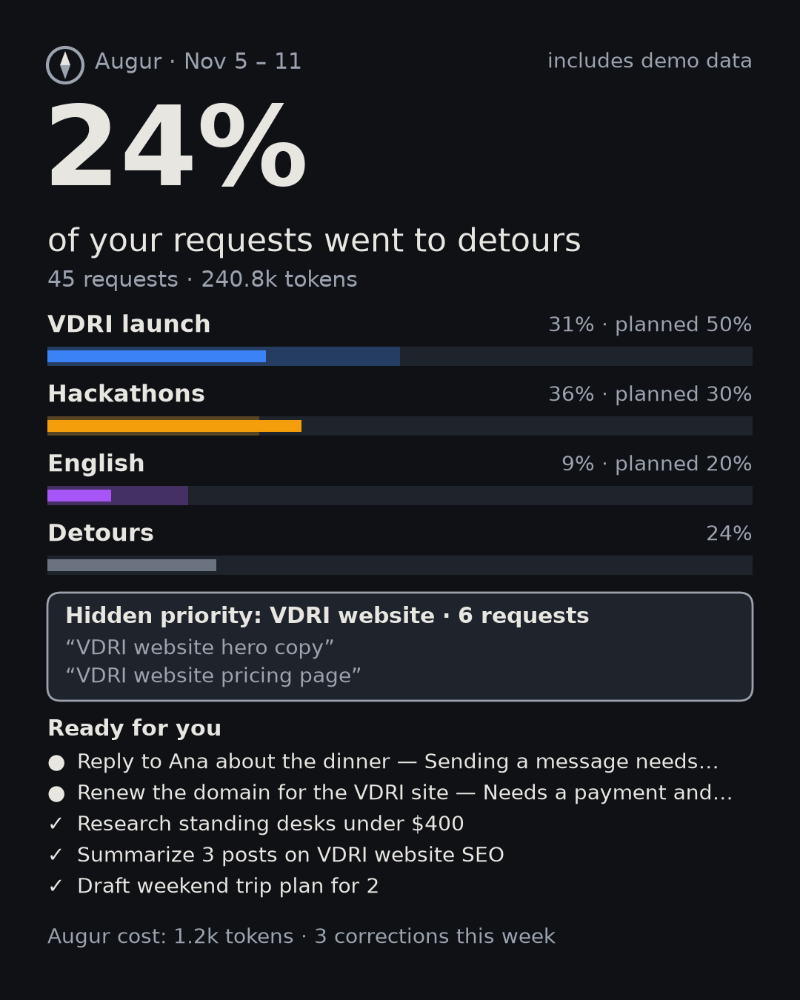
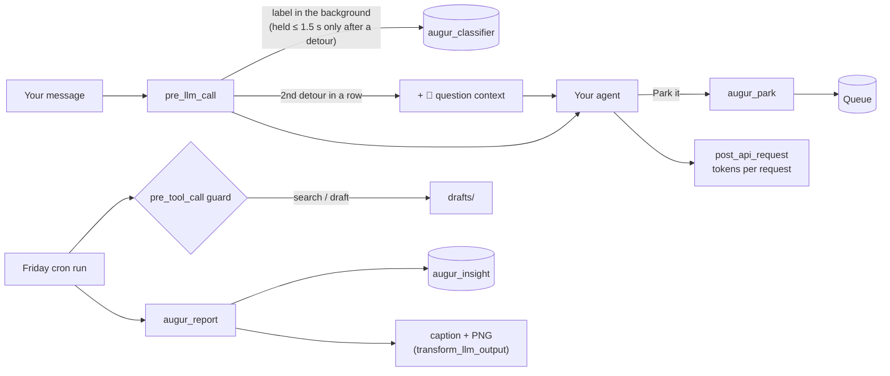

# 🧭 Augur

**Your agent knows your 3 priorities, notices when you drift, parks the detour, and on Friday clears what it can and shows where your attention actually went.**

[](https://github.com/Bruno-coder21/augur/actions/workflows/ci.yml)
· Hermes Agent plugin · `requires_hermes >= 0.23.1` · MIT

**▶ 35-second demo:** https://x.com/verona_M2/status/2120635657705984188

## Why

An agent that can do anything makes it easy to do everything. One quick question turns into a website tweak, then a trip plan, and the week's real priorities get whatever is left. Augur keeps your agent pointed at the 3 goals you chose for the week, without getting in your way.

## What it does

| Moment | What happens |
|---|---|
| **Goals** | `/augur goals ship the beta, hackathon, Spanish`. One tap picks the planned split (50/30/20…). |
| **Nudge** | Augur silently labels each request. On the **2nd detour in a row** your agent asks one short question before doing it: *"🧭 This is outside your goals this week (closest: Beta launch). Park it or do it now?"*, with buttons on Telegram. It never blocks you. |
| **Park** | "Park it" puts the detour in the **Queue** (`augur_park`, or `/park <text>` yourself). |
| **Friday run** | A cron job researches and drafts each parked item, marks what **needs you**, and sends the weekly report image. It can only search the web and write drafts, enforced by a guard. |
| **Hidden priority** | If 5 or more detours share a theme, Augur names the 4th priority you never declared and suggests swapping it in. |



`/augur` in the terminal (Telegram gets a compact version that fits a phone):

```
🧭 Augur · Nov 5 – 11  (includes demo data)

  Product launch  ▇▇▇▇▇▇░░░░░░░░░░░░░░   31% of 50% planned
  Hackathon       ▇▇▇▇▇▇▇░░░░░░░░░░░░░   36% of 30% planned
  English         ▇▇░░░░░░░░░░░░░░░░░░    9% of 20% planned
  Detours         ▇▇▇▇▇░░░░░░░░░░░░░░░   24%

  45 requests counted · 240.8k tokens

  Queue: 5 parked · no Friday run yet → /blueprint augur:friday
  Hidden priority: "Personal website" (6 requests) → /augur goals
  Augur itself used 1.2k tokens this week
```

Each goal keeps one color everywhere (terminal, PNG, Desktop): blue, amber and violet, chosen to stay distinguishable for color-blind users. Goal colors are used for goals only.

## Quickstart (under 60 seconds)

```bash
hermes plugins install Bruno-coder21/augur --enable   # or `augur` once it is in the catalog
```

Then, in any Hermes chat (CLI, Telegram, Desktop):

```
/augur demo                                   # see a sample week right away (marked as demo)
/augur goals ship the beta, hackathon, Spanish  # your real goals; this also clears the demo
/blueprint augur:friday                       # schedule the Friday run (default Fri 17:30)
```

Day to day you don't run anything: just work. `/augur` shows your week, `/augur report` sends the image now, `/park <text>` parks something by hand, `/augur fix` corrects the last label (Augur learns from it), and `/augur pause 2h` (or `off`) gives you quiet time.

Pin a fast, cheap model for the **Augur classifier** slot (`hermes model`). With a model that answers in about a second, the question arrives before your agent starts. When a label is late, Augur never makes you wait: it adds a one-line 🧭 note under the reply instead, and `/augur` warns you if that happens often.

## How well it works

The classifier is measured on 80 labeled messages: 3 user profiles (founder, developer, student), about two thirds English and one third Portuguese, with clear detours and hard cases (short follow-ups, mixed requests, small talk). 60 are the development set. The other 20 are a **held-out set written blind** by a separate agent and run exactly once.

Results with Claude Haiku 5.5 pinned for `augur_classifier` (full runs in [`evals/RESULTS.md`](evals/RESULTS.md)):

| Metric | Dev set (60) | Held-out set (20) | Target |
|---|---|---|---|
| Detour precision (flagged detours that really were) | **100%** | **100%** | ≥ 90% |
| Detour recall (real detours caught) | **100%** | **100%** | ≥ 70% |
| Goal accuracy on in-goal requests | **97%** | **100%** | ≥ 85% |
| Neutral messages (small talk, questions about the agent) never flagged | 100% | 100% | |
| Model latency p50 / p95 | 1.18 s / 2.07 s | 1.07 s / 2.15 s | p95 ≤ 1.5 s |
| Tokens per labeled message (mostly input) | ~1.2k | ~1.3k | |

Honest note on latency: the model's p95 is above 1.5 s. That is why Augur only waits for a label when the previous request was an open detour, and never longer than 1.5 s. Every other request is labeled in the background with no delay, and a label that arrives late turns the question into a one-line 🧭 note under the reply.

Precision comes before recall: a wrong nudge is annoying, while a missed detour costs little.

## Privacy and safety

- **Model calls:**
  - One short call per message of 15+ characters, through the `augur_classifier` auxiliary task. It sends your 3 goals, up to 8 of your corrections, the message (up to 1,200 characters) and your 2 previous messages (up to 400 each), all redacted first.
  - One call per weekly report, through `augur_insight`, with that week's detour summaries.
  - Slash commands, "ok"/"thanks" and short follow-ups make no call.
- **Stored data:**
  - Per request: date, goal, confidence, token count and a summary of at most 60 characters **written by the model**, never your text. A label that fails or is unsure stores no summary at all.
  - Your goal names (40 characters) and descriptions (160).
  - Parked items as you or your agent phrased them (60), Friday-run result lines (140), and the report PNGs and drafts.
  - Everything is redacted with Hermes's `redact_sensitive_text(force=True)` before it is stored. That masks secret-shaped tokens; names or details you type into `/park` are kept as typed.
  - Data lives in `~/.hermes/plugin-data/augur/` and follows your profile.
- **Retention:**
  - Labeled requests are deleted after 90 days.
  - Report PNGs are deleted after 8 weeks, and drafts after 30 days.
  - Parked items still waiting after 14 days are marked dropped.
  - Cleanup runs whenever a report is built.
- **Nudge text:** on the 2nd detour in a row, Augur adds a short instruction for the agent to that one message. Hermes keeps added context with the message in the conversation history.
- **Network and shell:** no network calls of its own, no shell commands, no reads outside its own data directory.
- **Output safety:** text Augur shows back (summaries, goal names, the hidden-priority theme, parked items) is stripped of terminal control characters and of anything the gateway would turn into a file attachment (`MEDIA:` tags, bare file paths).
- **Friday run:** a `pre_tool_call` guard limits the run to Augur's Queue tools, `web_search`, and `read_file` / `search_files` / `write_file` / `patch` on absolute paths inside its `drafts/` folder, with every V4A patch path checked. Everything else is blocked, including `web_extract`, the terminal, messaging and other plugins' tools, so anything that would need approval becomes "needs you". Queue items are passed to the model as data, never as instructions. The run's last message is written by Augur itself (caption and report image). The guard applies only to Augur's own cron job. That job keeps running if you disable Augur, so remove it with `hermes cron remove` when uninstalling.
- **One person per profile:** goals, the Queue and reports are per Hermes profile, not per chat member. Don't enable Augur on a profile that serves a group.
- **No telemetry, no self-update, no binaries.**

## How it works



| Surface | Used for |
|---|---|
| 6 hooks | `pre_llm_call` (label and nudge), `post_llm_call` (park or do-now decision), `post_api_request` (tokens per request), `post_auxiliary_call` (Augur's own cost), `pre_tool_call` (Friday guard), `transform_llm_output` (late 🧭 note, Friday reply) |
| 4 tools | `augur_park`, `augur_queue`, `augur_done`, `augur_report` |
| 2 auxiliary tasks | `augur_classifier`, `augur_insight` (each its own model slot) |
| 1 blueprint | `augur:friday` (time, day, deliver) |
| 2 commands | `/augur …`, `/park …` |
| Desktop | Status-bar chip "🧭 Hackathons · 62% on goals" with the week in a popover (`desktop/plugin.js`, RPC `plugin.augur.status`, live `status.changed` events) |

Reliability rules:
- Every hook returns `None` on any error.
- Augur holds a turn only when the previous request was an open detour, and never for more than 1.5 s.
- Low confidence means silence.
- The plugin never returns `block` from `pre_llm_call`.
- Unattended runs (cron, Kanban, webhooks, API server) are never labeled or nudged.

## Configuration

In Desktop → Settings → Plugins → Augur, or `plugins.entries.augur.settings` in `config.yaml`:

| Key | Default | Meaning |
|---|---|---|
| `language` | `en` | `en` or `pt`, for every message, panel and report |
| `max_nudges_per_day` | `3` | Augur stays quiet after this many nudges in a day |
| `nudge_cooldown_minutes` | `45` | No nudge in a session for this long after "Do it now" |
| `min_confidence` | `0.6` | Below this, a request is not counted and never nudged |

To pin a model for Augur's calls, pick it for **Augur classifier** and **Augur hidden priority** in the model screens (`hermes model`, or Desktop → Models), or set `auxiliary.augur_classifier.model` in `config.yaml`.

Known limit: "today" (for the daily nudge limit) and report dates use the gateway machine's local time zone.

## Roadmap

- Weekly report to a partner or co-founder through the gateway.
- A nightly guard that flags cron jobs drifting outside your goals.
- Parked items that come back due on Monday.

## Developer

```bash
python -m pytest -q                     # unit tests with a fake Hermes context and a fake LLM
hermes plugins doctor . --ci            # load it through the real plugin manager
hermes plugins validate . --install-deps
```

`/augur eval` (local surfaces only) runs the 60-message dev set through your configured `augur_classifier` model and writes `RESULTS-dev-*.md` to the plugin data directory. `/augur eval final` runs the held-out set; run it once, at the end. `NOTES.md` lists every Hermes API detail checked against the source. Contributions welcome: open an issue first for anything that changes what Augur stores or sends.
