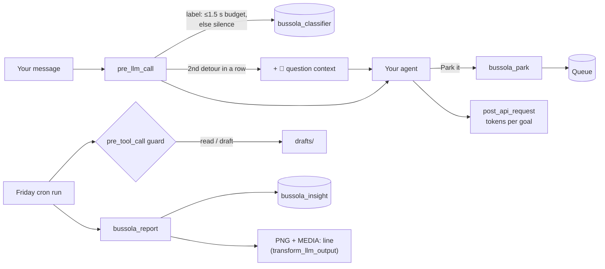

# 🧭 Bussola

**Your agent knows your 3 priorities, notices when you drift, parks the detour, and on Friday clears what it can and shows where your attention actually went.**

[](https://github.com/Bruno-coder21/bussola/actions/workflows/ci.yml)
· Hermes Agent plugin · `requires_hermes >= 0.23.1` · MIT

<!-- GIF: the 🧭 question and the "Park it" button on Telegram (10 s) -->

## Why

An agent that can do anything makes it easy to do everything. One quick question turns into a website tweak, then a trip plan, and the week's real priorities get whatever is left. Bussola keeps your agent pointed at the 3 goals you chose for the week, without getting in your way.

## What it does

| Moment | What happens |
|---|---|
| **Goals** | `/bussola goals launching VDRI, hackathons, English`. One tap picks the planned split (50/30/20…). |
| **Nudge** | Bussola silently labels each request. On the **2nd detour in a row** your agent asks one short question: *"🧭 2nd request off your goals (closest: VDRI launch). Do it now or park it?"* It never blocks you. |
| **Park** | "Park it" puts the detour in the **Queue** (`bussola_park` or `/park <text>`). |
| **Friday run** | A cron job researches and drafts each parked item, marks what **needs you**, and sends the weekly report image. It is read-and-draft only, enforced by a guard. |
| **Hidden priority** | If 5 or more detours share a theme, Bussola names the 4th priority you never declared and suggests swapping it in. |

<p align="center"></p>

`/bussola` in the terminal:

```
🧭 Bussola · Nov 5 – 11  (includes demo data)

  VDRI launch  ▇▇▇▇▇▇░░░░░░░░░░░░░░   31% of 50% planned
  Hackathons   ▇▇▇▇▇▇▇░░░░░░░░░░░░░   36% of 30% planned
  English      ▇▇░░░░░░░░░░░░░░░░░░    9% of 20% planned
  Detours      ▇▇▇▇▇░░░░░░░░░░░░░░░   24%

  45 requests counted · 240.8k tokens

  Queue: 5 parked · Friday run not scheduled → /blueprint bussola:friday
  Hidden priority: "VDRI website" (6 requests) → /bussola goals
  Bussola itself used 1.2k tokens this week
```

Each goal keeps one color everywhere (terminal, PNG, Telegram, Desktop): blue, amber and violet, chosen to stay distinguishable for color-blind users.

## Quickstart (under 60 seconds)

```bash
hermes plugins install Bruno-coder21/bussola --enable   # or `bussola` once it is in the catalog
```

Then, in any Hermes chat (CLI, Telegram, Desktop):

```
/bussola demo                                   # see a sample week right away (marked as demo)
/bussola goals launching VDRI, hackathons, English
/blueprint bussola:friday                       # schedule the Friday run (default Fri 17:30)
/bussola demo clear                             # remove the sample data
```

Day to day you don't run anything: just work. `/bussola` shows your week, `/bussola report` sends the image now, `/park <text>` parks something by hand, `/bussola fix` corrects the last label (Bussola learns from it), and `/bussola pause 2h` (or `off`) gives you quiet time.

## How well it works

The classifier is measured on a labeled set of 80 messages: 3 user profiles (founder, developer, student), 60% English and 40% Portuguese, with clear detours and hard cases (short follow-ups, mixed requests, small talk). 20 of the 80 are a **held-out set written blind** by a separate agent and run exactly once.

<!-- EVAL_TABLE -->

Precision comes before recall: a wrong nudge is annoying, while a missed detour costs little.

## Privacy and safety

- **Model calls:** one extra call per non-trivial message, through the `bussola_classifier` auxiliary task. It defaults to your compression model, and you can pin or change it. Plus one call per weekly report, through `bussola_insight`. Messages shorter than 15 characters and slash commands make no call.
- **Stored data:** date, goal, confidence and a redacted summary of at most 60 characters per message. Never the full text. Secrets are masked with Hermes's `redact_sensitive_text(force=True)` before anything is stored. Data lives in the Hermes plugin data directory (`~/.hermes/plugin-data/bussola/`) and follows your profile.
- **Nudge text:** on the 2nd detour in a row, Bussola adds a short instruction for the agent to that one message. Hermes keeps added context with the message in the conversation history.
- **Network and shell:** no network calls of its own, no shell commands, no reads outside its own data directory.
- **Friday run:** read-and-draft only, enforced by a `pre_tool_call` guard:
  - It allows Bussola's tools, plus `read_file`, `search_files`, `web_search` and `web_extract`.
  - It allows `write_file` and `patch` only inside `drafts/`, with every V4A path checked.
  - Everything else is blocked, so anything that would need approval becomes "needs you" instead of waiting.
  - The guard is active only in Bussola's own cron run.
- **No telemetry, no self-update, no binaries.**

## How it works



| Surface | Used for |
|---|---|
| 6 hooks | `pre_llm_call` (label and nudge), `post_llm_call` (park or do-now decision), `post_api_request` (tokens per goal), `post_auxiliary_call` (Bussola's own cost), `pre_tool_call` (Friday guard), `transform_llm_output` (guaranteed report attachment) |
| 4 tools | `bussola_park`, `bussola_queue`, `bussola_done`, `bussola_report` |
| 2 auxiliary tasks | `bussola_classifier`, `bussola_insight` (each its own model slot) |
| 1 blueprint | `bussola:friday` (time, day, deliver) |
| 2 commands | `/bussola …`, `/park …` |
| Desktop | Status-bar chip "🧭 Hackathons · 62% on goals" with the week in a popover (`desktop/plugin.js`, RPC `plugin.bussola.status`, live `status.changed` events) |

Reliability rules:
- Every hook returns `None` on any error.
- A slow model never delays you more than 1.5 s; a late answer is stored in the background without a nudge.
- Low confidence means silence.
- The plugin never returns `block` from `pre_llm_call`.

## Configuration

In Desktop → Settings → Plugins → Bussola, or `plugins.entries.bussola.settings` in `config.yaml`:

| Key | Default | Meaning |
|---|---|---|
| `language` | `en` | `en` or `pt`, for every message, panel and report |
| `max_nudges_per_day` | `3` | Bussola stays quiet after this many nudges in a day |
| `nudge_cooldown_minutes` | `45` | No nudge in a session for this long after "Do it now" |
| `min_confidence` | `0.6` | Below this, a request is not counted and never nudged |

To pin a model for Bussola's calls, pick it for **Bussola classifier** and **Bussola hidden priority** in the model screens (`hermes model`, or Desktop → Models), or set `auxiliary.bussola_classifier.model` in `config.yaml`.

## Roadmap

- Weekly report to a partner or co-founder through the gateway.
- A nightly guard that flags cron jobs drifting outside your goals.
- Parked items that come back due on Monday.

## Developer

```bash
python -m pytest -q                     # unit tests with a fake Hermes context and a fake LLM
hermes plugins doctor . --ci            # load it through the real plugin manager
hermes plugins validate . --install-deps
```

`/bussola eval` runs the 60-message dev set through your configured `bussola_classifier` model and writes `RESULTS-dev-*.md` to the plugin data directory. `/bussola eval final` runs the held-out set; run it once, at the end. `NOTES.md` lists every Hermes API detail checked against the source. Contributions welcome: open an issue first for anything that changes what Bussola stores or sends.
